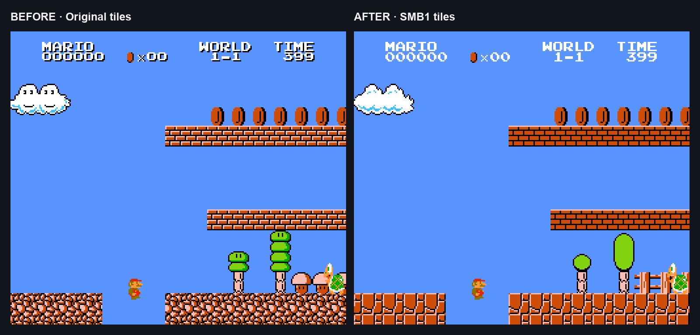

# Lost Levels Classic Graphics

Convert the Japanese FDS Lost Levels to NES, with SMB1-style scenery, platforms, mushrooms, bricks and castles. Includes the final scoped bridge and Blooper palette fixes. Original Mario and Luigi physics are preserved.

## Before and after



Same frame, player position and enemy positions in the middle section of World 1-1. Left: the original MMC1 conversion. Right: Classic Graphics. Captured from isolated sessions with identical inputs; enlarged with nearest-neighbor scaling.

## Create the NES ROM

1. Install [Python 3](https://www.python.org/downloads/) with Tkinter.
2. Run `python3 patch.py` (on Windows, `py patch.py`).
3. Choose your FDS ROM and donor NES ROM, then choose where to save the result.

The tool downloads the checksum-pinned official conversion patch. ROMs stay on your computer and are never uploaded. Input files are never modified and existing output files are not overwritten. No ROM or BIOS is included.

Prefer a command line?

```sh
python3 patch.py game.fds donor.nes -o enhanced.nes
```

For offline use, add `--upstream-patch official.bps` with the exact official patch linked in `LICENSES.md`.

## Required ROMs

| Input | Exact revision | Checksum |
| --- | --- | --- |
| FDS | Super Mario Bros. 2 (Japan) | MD5 `7f38210a8a2befb8d347523b4ff6ae7c` |
| Donor NES | Super Mario Bros. (World) (HVC-SM) | SHA-256 `f61548fdf1670cffefcc4f0b7bdcdd9eaba0c226e3b74f8666071496988248de` |

The optional 16-byte FDS container header is removed automatically. Other revisions are rejected. The donor NES header is part of its checksum.


The graphics are extracted from your SMB1 ROM. Poison mushrooms and Lost Levels-specific hazards remain identifiable. The scoped Blooper color correction also makes poison mushrooms dark gray in those areas. Start a new session after patching: old emulator savestates can restore old graphics and palettes. Your ordinary in-game save remains separate.

## Credits and licensing

This is an independent enhancement tool. The original NES conversion is by Simplistic6502, with web2000, threecreepio and pellsson credited upstream. Nintendo and the respective rights holders own the games. No affiliation or endorsement is implied.

Our Python tooling and enhancement recipe are MIT licensed. Upstream conversion patches are downloaded directly from their authors; they are not bundled or relicensed.  See [LICENSES.md](LICENSES.md) for the review and pinned sources.
